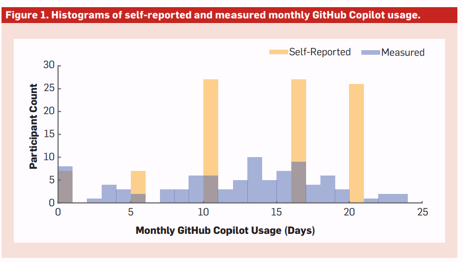

# AI Metrics and Productivity <!-- omit from toc -->

- [DORA, Google Cloud: The ROI of AI-assisted Software Development](#dora-google-cloud-the-roi-of-ai-assisted-software-development)
  - [Highlights](#highlights)
- [Beyond the Hype: The Efficiency Throughput Gap with GitHub Copilot](#beyond-the-hype-the-efficiency-throughput-gap-with-github-copilot)
  - [Highlights](#highlights-1)
- [Vericoding](#vericoding)

## DORA, Google Cloud: The ROI of AI-assisted Software Development

- [Source](https://services.google.com/fh/files/misc/dora-roi-of-ai-assisted-software-development-2026.pdf). Published April 2026.

### Highlights

> "We anticipate that most organizations will encounter a J-Curve: a temporary productivity dip and period of instability associated with early adoption" p4

  - Wondering - for places like Google? What about organizations that don't have quick feedback loops for work quality? Skill decay over time with no consequences can create a disaster. How are we training the next generation of engineers?

> "The 2025 DORA report found a positive impact of AI on productivity in several ways: Increased AI adoption was associated with an increase in individual effectiveness this was the strongest effect, compared with all other outcomes of AI adoption that were studied." p19

  - Not sure how "individual effectness" can be quantified especially with data showing that developers seem to overestimate their productivity gains from AI - some of them even lose productivity. 

>"It's important to note that in the 2025 DORA report, increased AI adoption was associated with an increase in software delivery instability." p.19

  - Okay soo..what about that individual effectness?!

>"To flatten the J-Curve and safely manage AI-accelerated development, organizations must invest in their underlying engineering platforms, emphasizing strong version control practices and small batch sizes to catch errors before they reach the user." p19

  - This is not helpful information

>"For an individual developer, AI does not necessarily make friction vanish; rather, the friction moves. The effort saved from manually writing voilerplate code is often replaced by a verification tax - the cognitive load required to iterate on prompts and rigorously audit AI-generated code that looks remarkably similar to correct code." p20

  - Agree. That shift is also mentally taxing.

>"When we think about AI improving productivity, we also expect AI to help reduce cost - both in IT and in business processes. However, this happens only when AI is replacing work that is not needed anymore." p21

  - If AI can't be trusted to independently verify what it created, you're just hitting another bottleneck. Prompt quality and inputs matter a lot - the AI agents are often capable of creating quite a bit if you describe exactly how you want it. The problem is that people don't know what they want, or they are trying to solve the wrong problem, or they are just expecting the AI to read their minds and not providing enough guidance. I would argue AI is asking for a new kind of skillset; I'm not sure how that reduces costs overall. So I would argue this shares the 'the friction doesn't vanish, it moves' sentiment from p20. 

>"The time saved by individuals by using AI - which we are translating into avoided cost for additional headcount. When our developers are more productive, we can reinvest the freed-up capacity into more valuable work and we don't need to hire additional developers."

  - Are *teams* more productive and making higher quality code? Also this sounds like "squeeze more work out of your teams". Plus hiring slowdowns. Exactly what software engineers want. Still waiting for actual numbers.

>"The revenue from extra feature deployments. When our developers are more productive, we can ship more features to market faster and generate additional revenue for the company." p24

  - Sure you can put new features out quicker but so can your competitors. When it comes to software, building more shit doesn't mean more money. I don't think users want to be overloaded with features, but I suppose I could be out of touch with what majority of users want.

>"We strongly recommend organizations do not adopt a headcount-reduction strategy, which has a negative impact on morale and organizational culture, can reduce efficiencies, and can even incentivize workers to not improve their work processes. Instead, this effort should be reinvested into new innovative or more productive work." p24

  - Don't piss off the peons otherwise they won't invent ways to be more productive!

>**Headcount reinvestment capacity = Staff size * Fully loaded salary * Net time saved per developer**

>"In our example, if we assume a fully loaded salary of $176k, that gives us $11M of savings." p25

>**(Target features deployed = Current features deployed) * Idea success rate * Revenue impact * Portfolio revenue**

>"For example, for a company with a porfolio revenue of $100M, six additional features per year, each with a 33% success rate and 0.5% revenue imipact, that would give almost $1M of additional revenue." p26

  - What about continued maintenance of these new features? How large are these new features? Do you reach a point of feature-saturation on existing products? What about inventing new products? I don't know what the point of these numbers are tbh but seems like people are expensive.

>"The DORA research found that AI adoption, coupled with the capabilities, produces better product performance. A better performing product will make users happier. This is likely to have a revenue impact because happy users buy more. It is a relatively loose link though, so we are not pursuing it in our calculator. Instead we focus on additional revenue or costs avoided, such as reputational damage, due to reduced downtime of the applications. Please note that the outcome of this calculation may also be negative due to the 'instability tax'. In that case, revenue is lost and / or additional cost incurred due to additional downtime." p27

  - When does the instability tax go away? Does this mean companies who get their shit together first will be more competitive? Or does that not matter anyway since 'happy users buy more' is a 'loose link'?

>"AI assisted software development naturally increases team velocity and the volume of generated code, which brings more pressure on the code review process. This 'verification tax' represents the extra time invested in automated testing or synchronous code reviews required to handle the higher volume of outputs. [..] The higher the verification tax, the fewer annual software deployments will be possible. Similarly, the lead time for changes will increase because of this heightened verification burden. Teams can compensate for this risk by implementing technical guardrails, such as nonoptional checkpoints and pre-commit hooks paired with static analysis to catch known vulnerabilities. Additional opportunities to counter these costs include investing heavily in automated testing, leveraging AI to assist with code reviews, and providing better context to the AI to improve initial code quality." p33

  - Okay so until mature AI infrastructure and strategy exists and gets adopted, we are stuck in a verification bottleneck and experiencing skill decay.  

>"Research analyzing tends of thousands of engineers reveals that while artificial intelligence yields a 35 - 40% productvitiy gain on simple, greenfield tasks, its impact on complex, legacy brownfield code is often 10% or less." p36

  - AI prompting is the Jira ticket grinder. Make really well-written tickets with expected behavior criteria with small scoped tasks and it should do pretty well with some light human review (imo). But how well does the average engineer write a good Jira ticket? lol

>"When an organization's internal knowledge graph is fragmented or outdated, AI generates bloat, duplicated or irrelevant code that creates long-term technical debt. Successful adoption requires treating internal technical data as a first-class citizen, ensuring that agents have the ground truth needed to make accurate decisions within the specific context of your code base." p41

  - Just had an issue last week where Opux 5.5 wanted to introduce an internal data model when we already had an internal data model in the project, which had a responsibility of translating `SchemaA <-> internal data model <-> SchemaB`. Basically inserted another internal data model when giving it a high level goal. Without enough context, weird shit happens.

>"In an agentic world, garbage in, garbage out refers to the context provided to the agent. Remember, AI is an amplifier. Without a robust foundation, AI generates bloat, redundant or low-quality code that creates a long-term maintenance tax." p44

  - Good luck improving those garbage inputs

>"Developers must be equipped to act as high-level orchestrators, providing agents with precise business context and maintaining rigorous oversight." p44

  - This doesn't sound promising??

>"ROI is measured by how much latent human creativity your organization can unlock through clearing systemic toil." p47

  - Agree to an extent. Wondering what percentage of personnel are going to innovate and provide creative solutions? How many ideas will have value and not just move the bottleneck from one place to another? 

## Beyond the Hype: The Efficiency Throughput Gap with GitHub Copilot

- [Source](https://cacm.acm.org/research/beyond-the-hype-the-efficiency-throughput-gap-with-github-copilot/). Published October 2026.

### Highlights

>"Achieving organizational productivity gains requires more than deploying an AI-powered tool. It demands a deliberate effort to learn, adapt, and reinvent teams, processes, and infrastructure to align with AI-augmented developer capabilities."

>"The act of measurement can inherently alter the state of a system, a phenomenon observed across diverse domains, from electrical circuits to quantum mechanics." 

  - This is interesting in that if you tell builder agents to record certain metrics, it could definitely have an impact on their behavior.

>"Our findings challenge the prevailing narrative of instant AI productivity gains: Despite observing improvements in engineer motivation and perceived skills, as well as reduced working hours, we found no immediate increase in key engineering metrics such as monthly pull requests and lines of code. This result underscores that effectively realizing the potental of AI-powered tools requires continued innovation and optimization of software engineering operations."

  - Alright so self-reported data among engineers is probably kinda garbage.

>"Time allocated to more human-centric areas, such as communication, waiting for decisions and dependencies, company processes, engineering processes, and inefficiency of engineering infrastructure, did not show statistically significant changes."

  - Maybe software engineering isn't the most critical area to apply AI towards, when it comes to increasing productivity.

>"Participants reported Copilot to be most useful for boilerplate code, function templates, queries, configuration files, and testing. They found it less capable, however, of developing front-end components and back-end services, writing complex logic or algorithms, and supporting human-centric enterprise development activities."

  - This agrees with what the DORA report was saying as well

>"This field study of GitHub Copilot productivity impact moves beyond the hyper of instant gains by identifying an efficiency-throughput gap, rebealing a more nuanced reality than that often presented in existing research and marketing."

  - Aren't most large companies spending resources on researching AI the same ones that gain by making it sound good to other folks?

## Vericoding

Vericoding is the idea that we can use math proofs to verify good coding behavior.

Math people trying to solve software problems is always fun. I don't know if this is the best solution to the verification bottleneck problem.
