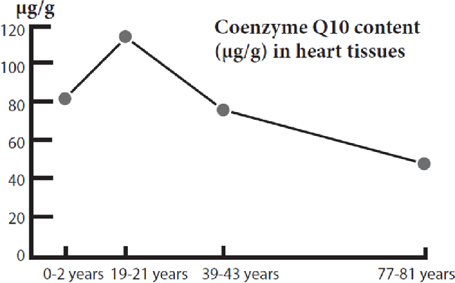
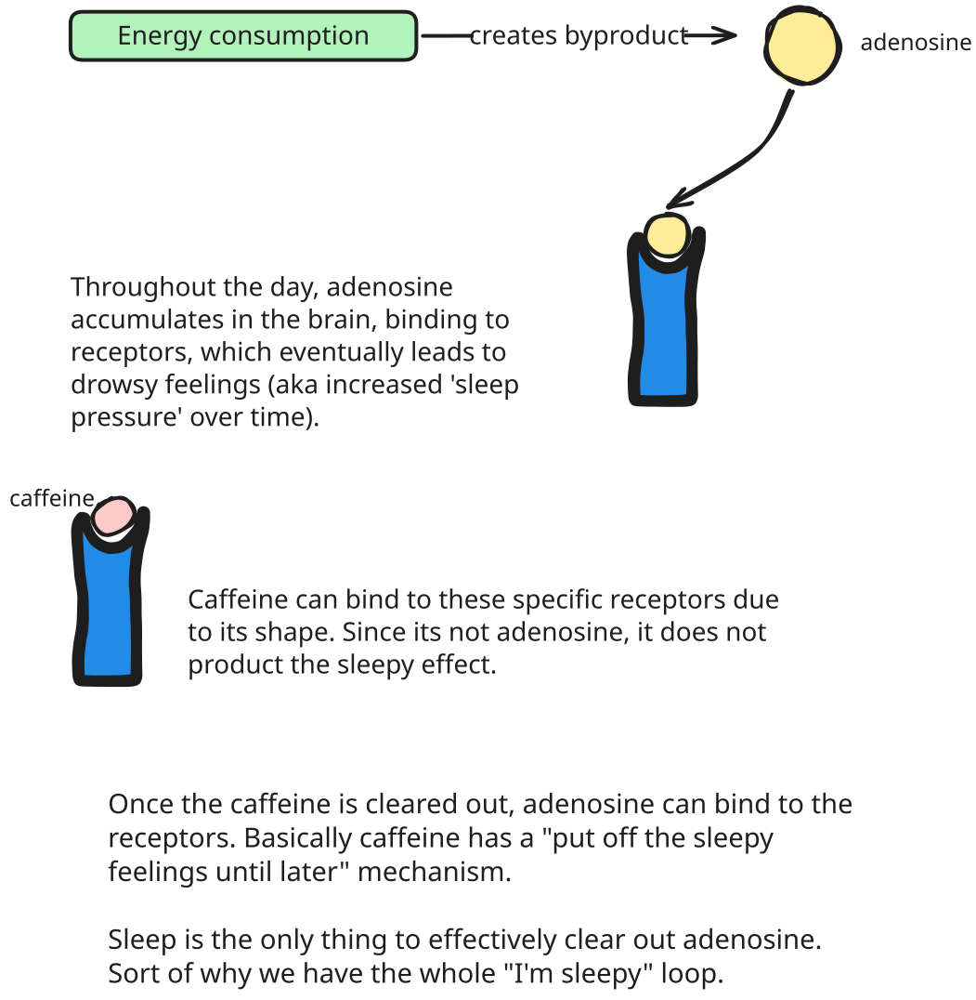

# Biohacking

"Biohacking" sounds like a really cool, futuristic concept. However the year is 2026 so instead of interesting CRISPR @ home modifications, neural interfaces for brain <-> machine connections (full-dive VR when?) and really freakin' cool body modifications we have pills, cold showers and practicing mindfulness. Yah, I'm disappointed too. We live in the dark ages.

# Pills

## General Energy

### NAD+/Niagen (nicotinamide riboside)

>> Form of Vitamin B3 that converts into NAD+ which fuels celluar energy production and repair. Natural levels of NAD+ decline with age. Niagen/NR can be taken orally to raise NAD+ levels. NAD+ can also be injected subcutaneously.

  - **Personal Experiences**:
    - Greater physical stamina (post-work, post-exercise, long days)
    - Better recovery from physical injuries, maybe viruses
    - Maybe better sleep, but hard to say (maybe an indirect benefit for some folks since studies aren't showing much support for sleep benefits directly)

- **Source**: [TruNiagen 300mg/daily, Amazon](https://www.amazon.com/300mg-Winning-Patented-Boosting-Supplement)
  - Thorne and Pure Encapsulations are also reputable brands of Niagen ; quality matters here since the top, more expensive brands get quality control testing. No-name brands aren't necessarily 'scams' but they might not contain the dosage advertised.
  - I've take the 300mg but 1000mg dosages are also offered, which some people might have more success with.

- **Additional Comments**

- NAD+ has been trending as an 'anti-aging' injectable from several telehealth wellness companies like [AgeRX](https://get.agelessrx.com/energy/nad-injection). I've have tried the injectable form of NAD+. NR supplementation is just as effective.

### CoQ10 Enzyme

>> Like NAD+, CoQ10 is another general cellular producer. Behaves as an antioxident and supports . Also like NAD+, natural levels decline with age beginning in ~ late 20's.

- **Source**: [Nutricost Coenzyme Q10, Amazon](https://www.amazon.com/Nutricost-CoQ10-Veggie-Capsules-Servings)

**Additional Comments**

- NR/NAD+ supplementation has a greater energy boosting effect for me than CoQ10, but it's economic enough for me to keep it in my regime.

<em>https://www.researchgate.net/publication/352360505_Coenzyme_Q10_supplementation_-_In_ageing_and_disease</em>

### L-Theanine (with Inositol)

>> Amino acid found naturally in tea leaves. This is commonly combined with caffeine to reduce jitter/anxiety effects of caffeine while keeping mental clarity. It has calming effects overall. Inositol is found in some blends due to its ability to aid in the 'good mood' effects.

- **Source**: [L-Theanine 200mg w/ Inositol, Amazon](https://www.amazon.com/NOW-L-Theanine-200-120-Capsules/dp/B00GQV9YX6)

### Ashwagandha

>> A popular organic supplement, Ashwaganda is one of those all-in-one boosters; memory, sleep quality, anxiety & stress reduction, list goes on. It does take a while (several weeks to a few months) to feel the full effects which can be subtle especially if not in-tune with day-to-day or week-to-week bodily changes.

  - **Personal Experiences**:
    - Greater sleep quality
    - Improved baseline for stress and anxiety

I take the KSM-66 type but don't have a go-to brand.

### Nicotine

>> Nicotine is a powerful nootropic when taken as a non-regular user. Nicotine patches cut down into smaller doses acan be a good way to boost a crunch session that will take a lot of mental energy. I don't recommend using it often due to tendency for addiction, especially if you have a history of smoking.

- **Source**: [CVS Nicotime Patches 21mg, CVS](https://www.cvs.com/shop/cvs-nicotine-transdermal-system-21mg-patch-step-1-7-ct-prodid-1280179)
  - It's most economical to get the largest dose and cut the patches down. Patches come in 14mg and 7mg doses as well.

### Caffeine

>> Caffeine is well-known and widely accepted - however there's some limitations and cautionary usage around it.

<em>Caffeine can also boost mood since it is sitting in receptors that would normally reuptake (clear/recycle out) mood-boosting neurotransmitters like dopamine and seratonin. Awareness of its mechanism can help decide when and how often to ingest.</em>

# Notes

- [NootropicsDepot](https://nootropicsdepot.com/all-products/
) is a great website for browsing around nootropics. While their quality control is awesome, they don't have the most economic prices so I don't necessarily recommend buying from them.