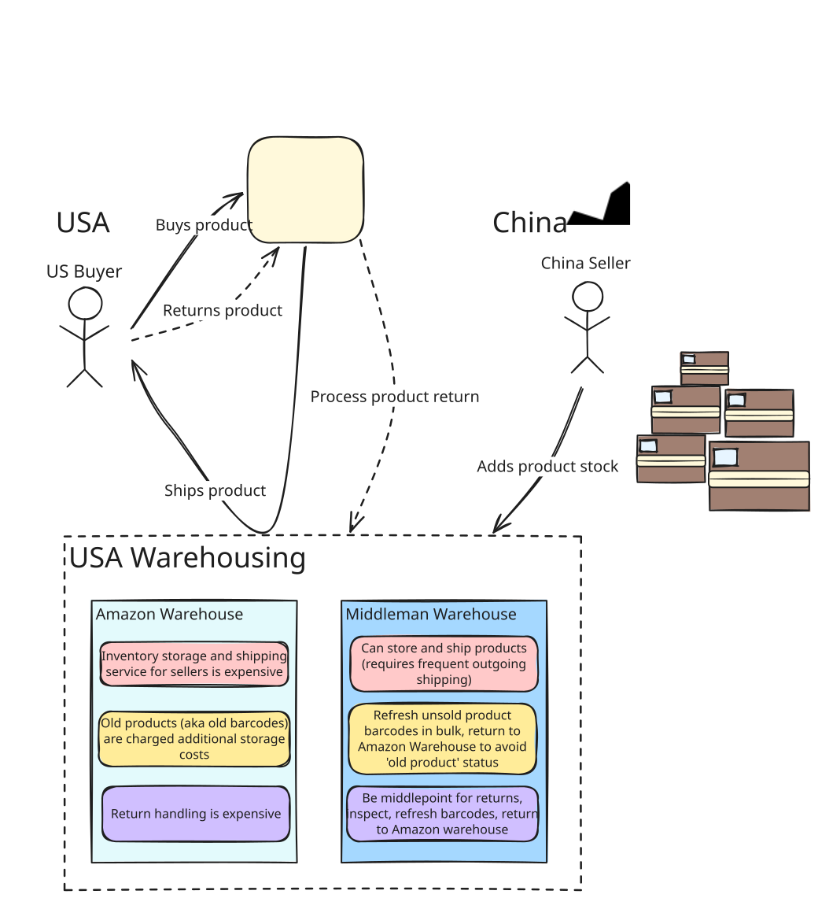
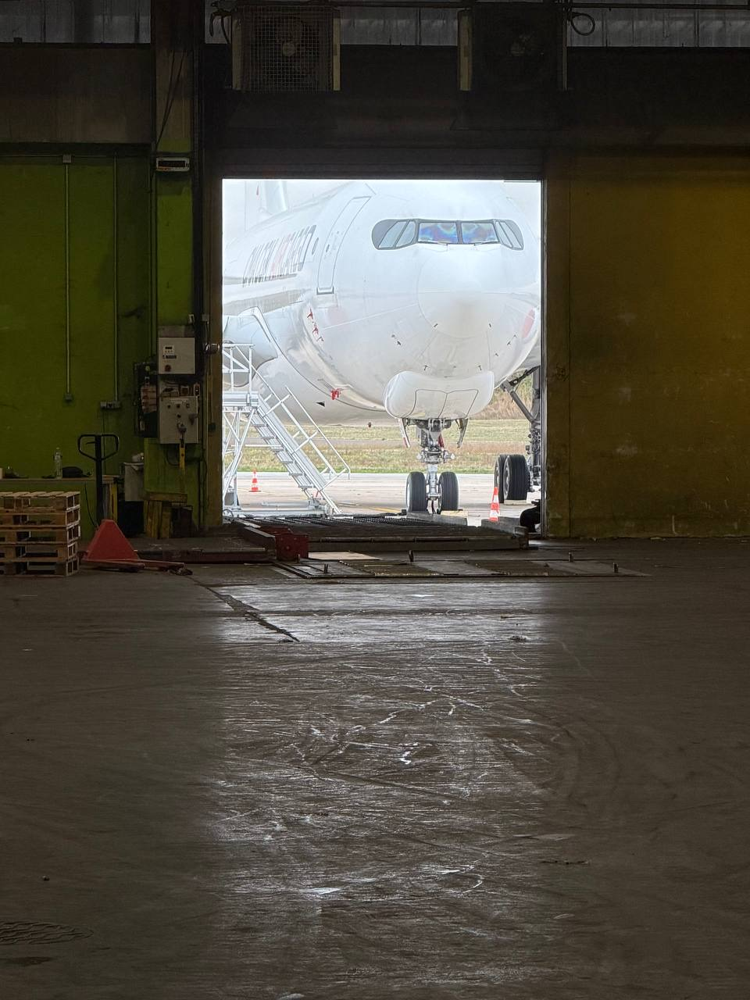

# Business Post-Mortem

A few years ago my husband paired up with an old friend to expand a small business model that is known to be profitable. 

He had a friend from high school (we'll call him EBP, short for ex-business partner) in Illinois who has a wealthy family in China. Said family really wanted EBP to find some success, so agreements were made to have EBP's family fund (~$200k) a business venture to expand this business model.

In the end, most funding was not provided for a variety of reasons, and the business failed. Psychologically, this can be hard and a huge hit to self-esteem and willingness to try again. As mostly an outsider, I think the experience was extremely informative and 'failure's are necessary to learning.

This is a brief post-mortem evaluation of the business model.

## The Business Model

The **middleman warehouse** is the business venture here. This business model was discovered as an existing successful business model via my sister-in-law.

My husband started off working in my mom's garage at a small scale. The bottlenecks with this scale were labor/time and physical space. With the addition of funding via EBP, expansion to more clients would be possible. 

A company was set up via a bunch of paperwork, payroll put in place, warehouses were shopped for and clients were accumulated.

However, **the promised money to fund the business fell through**, resulting in:

- Falling behind on warehouse rent
- Not enough money to hire additional labor
  - A sort of drifter type was hired and while he had a good work ethic, he had reading issues which made his productivity wane. He also tried to bring his teenage son to help but the son wanted to play on his phone
- Lack of vehicle made incoming and outgoing shipments difficult
  - The warehouse chosen was a warehouse suite within a larger warehouse. It was not set up to easily retrieve packages from the dock so my husband paid a UPS driver some money to regularly help them move packages to their unit.
- Organization of inventory suffered
  - Shelving, scanning and software tools were never applied to help maintain inventory which led to lost time and increased errors

>> XBP was also not very helpful at all in running business operations or really working in general (needed to be woken up in the mornings, for one). XBP isn't a 'bad person' and this isn't meant to demonize him. His purpose was mainly to be a source of financial means, which were not successfully provided as discussed.

## Additional Notes

- Finding more clients is never an issue. Smaller time, annoying clients are the newbie tier, but with reputation gain, high-volume clients is an option. This is better for streamlining the business instead of managing a bunch of random products across numerous small-time sellers. In fact, there's **yet another middleman** for the middlemen! As in, a Chinese point of contact who has clients, takes a cut for hooking up middlemen warehousers to Chinese sellers. Yay middlemen!
- Free samples were sort of an unofficial part of the process. We got lots of little random toys, a robot vacuum, some lego kits. One time a case of Pokemon cards showed up at the warehouse though it was not clear where it came from since none of the clients sold Pokemon cards. I got to keep it! It was during a time when I frequented this cute little [hobbyist trading card shop near me](https://maps.app.goo.gl/8Zgbpg6D3difYG6LA), run by a man and his father (they are adorable!).
- Sister-in-law & boyfriend warehouse in France is doing very well; they've just expanded to a new unit that is within an airport for quick/easy product management. Important to note they've migrated into selling (known) counterfeight products since there is a high demand for doing so.

