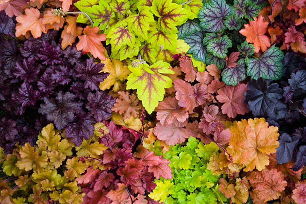
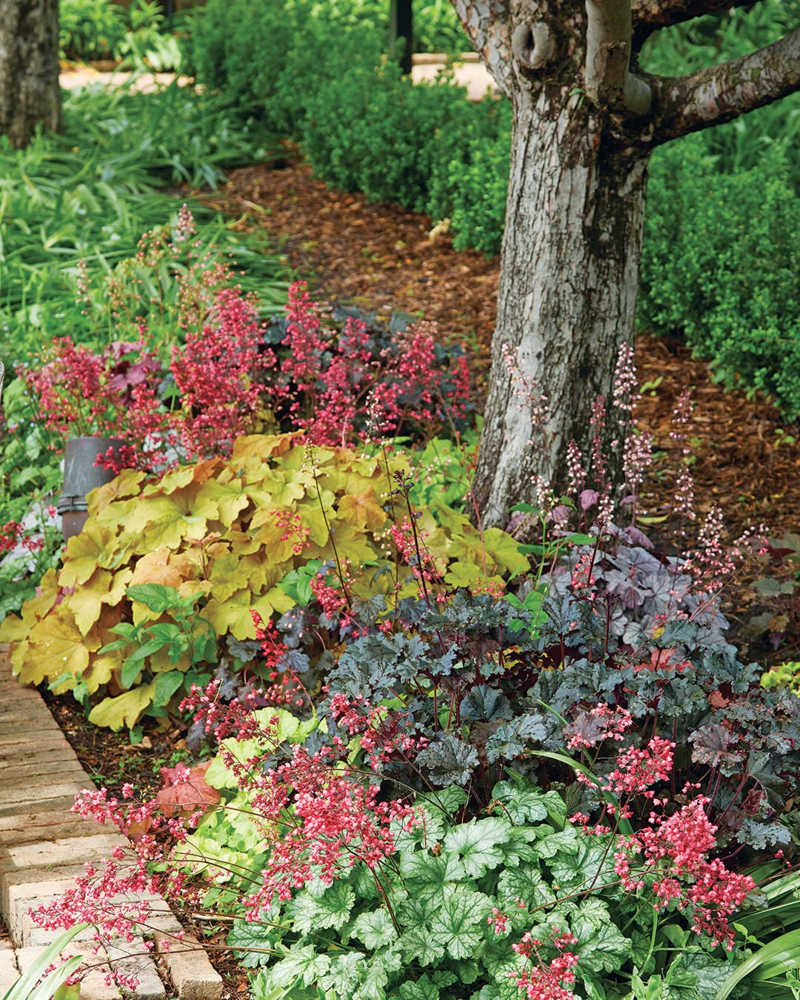
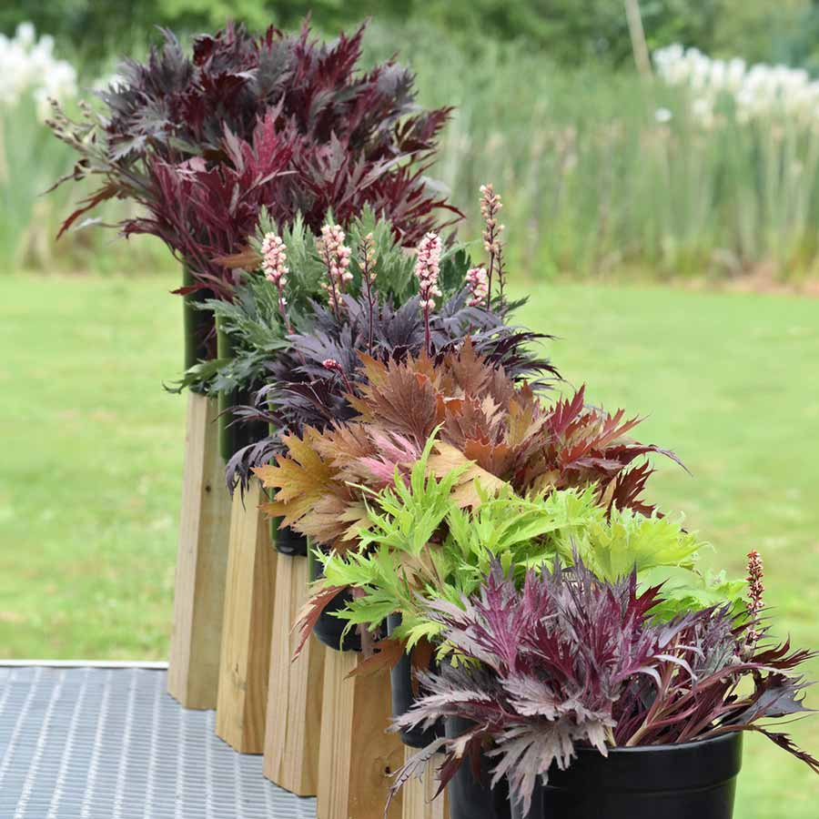
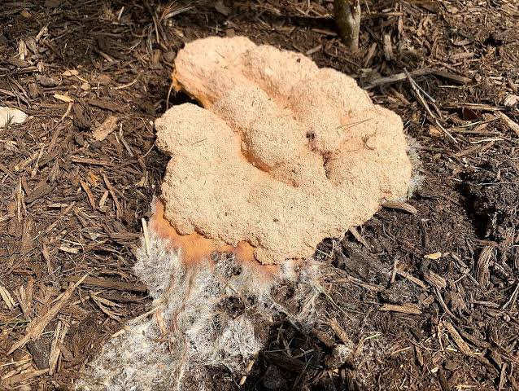
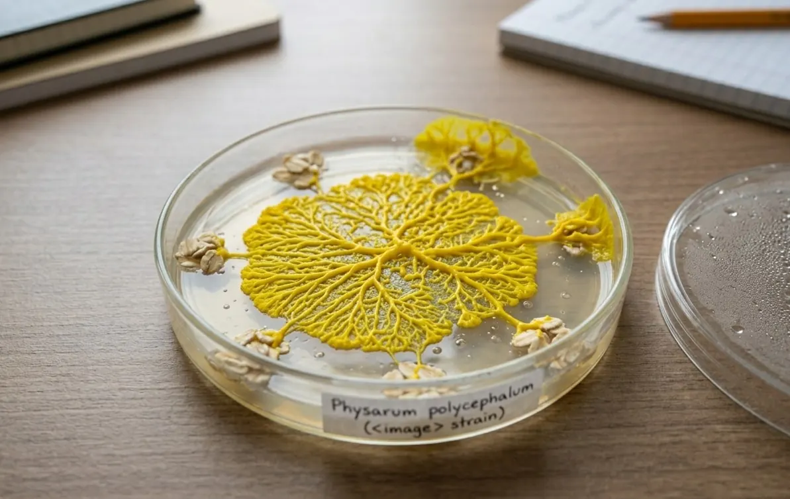
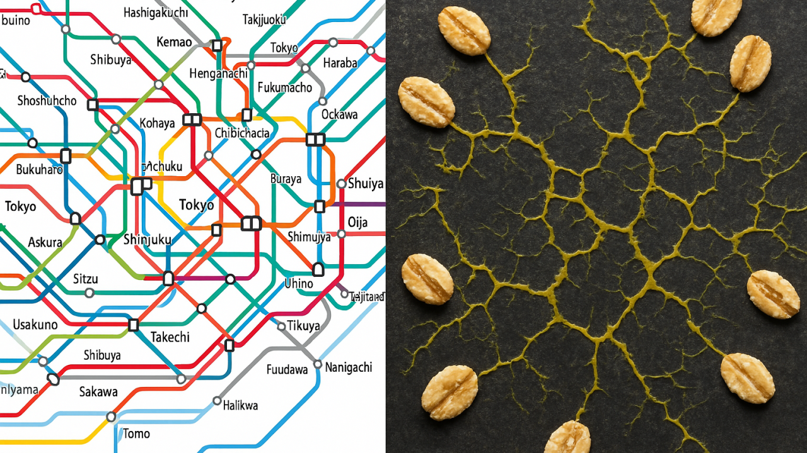

# Coral Bells and Other Tales <!-- omit from toc -->

- [Coral Bells](#coral-bells)
- [Dog vomit? No, it's slime mold!](#dog-vomit-no-its-slime-mold)
- [Weather, Seasons, Chicago: A Personal Note](#weather-seasons-chicago-a-personal-note)
  - [Winter Moods](#winter-moods)
  - [Where's the snow?!](#wheres-the-snow)
  - [I like it here](#i-like-it-here)

## Coral Bells

Coral bells are one of my most favorite plants. They offer:

- a lot of year-round color in their folage
- More color when they flower (each type has a different bloom length and color)
- Resiliency - they aren't delicate and can tolerate a wide variety of environments
- Easy reproduction via plant separation. 

This year, the Fyre Wing series was created by [Terranova Nurseries](https://www.terranovanurseries.com/products/heuchera-fyre-wing-series/). 

This is the first time I've seen coral bells with this style of leaf shape! I love these variations! I ended up buying 1 of each from [In the Country Gardens & Gifts](https://shop.inthecountrygardenandgifts.com/collections/fyre-wing-heuchera) and planting them this fall.

## Dog vomit? No, it's slime mold!

Slime mold is something I've seen crop up in the garden now and then when I lay down fresh layers of mulch.

The wood-loving species (*Fuligo septica*) sometimes gets mistaken for dog vomit.

One cool thing about slime mold is that it's incredibly efficient about finding the shortest path to a resource, even when obstacles are in play. It's a wonderful representation of evolution's amazing capabilities.

When used in a study where a species of slime mold (*Physarum polycephalum*) was laid over a map of tokyo, with urban centers offering 'food', it recreated the tokyo rail line system almost identically - and the slime mold's paths were actually **more efficient** than the human-designed railways. It is basically a very smart path-finding algorithm that is alive and food-motivated.

It sort of makes you wonder why we don't use more applications of biomimicry - why try to spend a bunch of energy calculating and predicting efficient transport systems when you could already use a refined algorithm like slime mold?

I wonder what else we can learn from nature.

## Weather, Seasons, Chicago: A Personal Note

### Winter Moods

I've always been sensitive to the seasons - a lot of my darkest periods mood-wise have been in the winter. 

Moving from Colorado to Illnois has been life-enriching but winters still remain difficult for those with seasonal affective disorder (SAD). 

I thankfully have found a great psychiatrist to help me manage medications on sort of an adjustable cycle instead of the same treatment 24/7/365. I also have a therapy-grade sun lamp (it apparently makes a difference compared to the tiny cheap ones on Amazon!) to use in the mornings.

### Where's the snow?!

Thanks to El Nino, it's been an unusually wet year. On the plus side, the plants are happy and thriving! 

As I write this on 11/7, we still haven't gotten first frost. So, the plants are still alive - I actually have a few confused bulb-based plants that are trying to emerge (NOT YET, it isn't spring! go back to sleep!!). Instead of snow, we're still getting light rain showers.

The average date for first frost in Chicago is October 19th, with the latest ever recorded date on November 24th, 1931.

The stereotype of Chicago being overly cold has yet to manifest since I've moved here, which I suspect might be due to climate change trends. Decades ago, the climate probably felt a lot more harsh in winter time.

### I like it here

Everyone who has visited us out here has found it surprisingly lovely and flirted with the idea of moving here. The suburbs are particularly enticing with a high inventory of charming older homes, areas with solid school systems, community care focus and a wide demographic of people and cultures. I prefer quiet, green suburbs while my husband prefers the bustle and shopping options of larger areas (plus a Chinatown). This area offers the perfect blend of both plus numerous diversity benefits:

- As a biracial person of white and black ethnicity, who is often mistake for Hispanic ethnicity, it's been refreshing to see wider diversity among social classes than I did back in Colorado where I grew up. 

- As a man married to another man, I feel less on edge, less worried about how I'm perceived. 

- As a person married to an immigrant, I feel right at home. There are tons of immigrants here - and not just from Mexico. I've encountered people from all over the world. No one bats an eye at anyone based on appearance, which is nice. 

I joked with an old Denver-based friend - who often gets unsolicited ethnicity-related comments on her appearance - that white people here don't give that wide-eyed "what ARE you?" look, insensitive questions or asking to touch your hair. I don't mind curiosity but it can get lonely when you're reminded about how you're an 'other' and how you don't really blend within the group. When people live in a melting pot, it becomes their baseline of normal - it's not like people are consciously *trying* to be rude or accepting. It's just a result of their environment and experiences.

There's a sort of culture here I find easy to understand. There's politeness reminiscient of the midwest, with the realness and no-nonsense of the east coast. There's also a strong Chicagoan pride; this level of pride and culture was something I never experienced growing up in Denver.

The higher population overall affords me access to a diverse range of services and doctors - which is necessary for me:

- I saw an endocrinologist 5 minutes away who was very rude - no problem. I found an amazing one 20 minutes away. 
- Music lessons? 3 blocks away. 
- Food? Endless options. 
- Need a handyman on Thumbtack? Loads to pick from, with (imo) fair pricing. 

And don't get me started on the karaoke options! There's just more of **everything**. It's not NYC, the ultimate queer folk haven, but it's a hell of a lot cheaper and greener.

