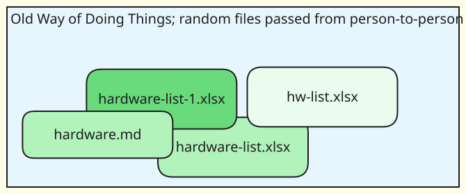
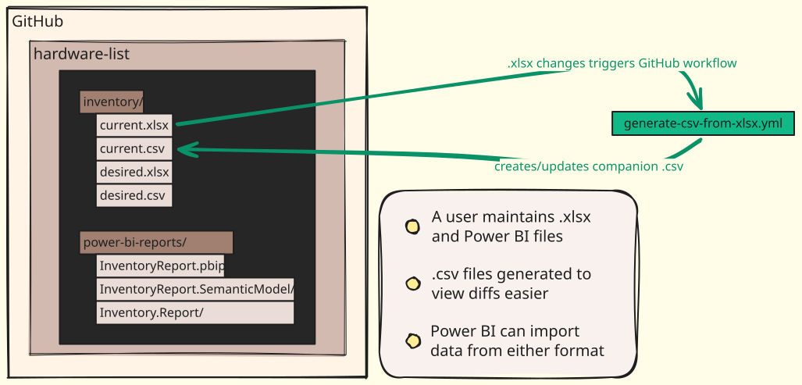

# GitHub For Noobs

GitHub is such a great tool, even for codeless projects.

## Scenario

*~Imagine~* an inventory owner has to keep track of various types of machines and hardware that live in different locations, contain different networking configurations and belong to different groups of people.

A naive attempt would be the "just wing it" approach:

However, with this approach you could end up with a mess! No one would be happy about this in a workplace.

Also *~imagine~* a conversation between the inventory owner (`INV_OWNER`)  and the business process owner (`BP_OWNER`) going poorly and down an unproductive road:

> `INV_OWNER`: I tried xyz and it's not my fault blah blah.
> 
> `BP_OWNER`: We need to figure out something that works because there's an issue.
> 
> `INV_OWNER`: Tracking inventory in Jira is not a good idea. Blee blah Atlassian sucks.
> 
> `BP_OWNER`: Blah blee blah, business business, we need xyz 
> for Power BI. All hail Jira.
> 
> `INV_OWNER`: \**annoyed verbal spam*\*
> 
> `BP_OWNER`: \**irritated verbal spam*\*
>
> etc.

Looks like it's time for a solution!

## Solving the Problem

### Constraints

- **Jira** for change tracking
- **Power BI** needs data input
- **GitHub** as version control platform

### Solution

## Additional Thoughts

Version-control could be embedded in noob-friendly applications so that diff changes and version changes are easier to see. A lot of word document-related applications will have a history change list of some sort - I find these to be a bit clunky. 

Why not utilize the concept of pull requests instead of commenting all over documents when people review each other's changes? Git seems like a more powerful solution to me. But I suppose I'm biased.
