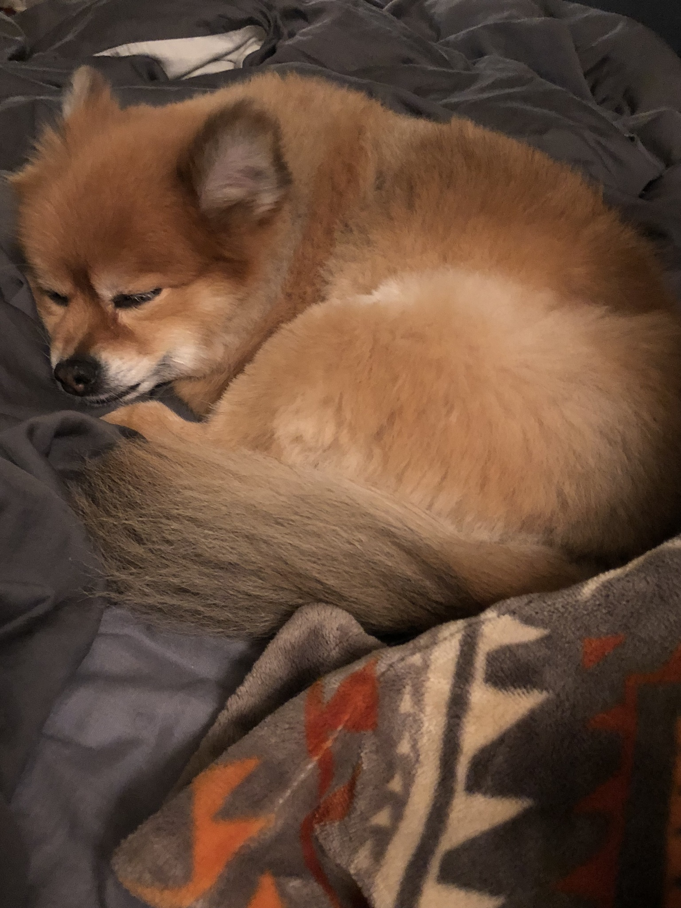

# Skipper

I got Skipper when I was at the tail end of working my first job at a dog daycare. It was 2010. I was about to turn 18 years old. 

Now, I came into the dog daycare with a disdain for small dogs. A REAL dog is big, strong and can guard the house at night. Who would want to get a "little rat dog"?. Over my time working at the dog daycare, this view slowly changed. I got to know many small dogs with wonderful personalities - not rat-like or chihuahua-crazy at all! 

A favorite time killer my dog-loving coworkers and I liked to do was to go on Petfinder.com and window shop for dogs. I was helping a coworker window shop for a second pomeranian; she'd flirted with the idea of getting a female to accompany her current male pomeranian. One day, I stumbled across a posting for a male pomeranian - 5 months old. The picture was horrible, blurry and the eyes were doing that red-glare thing that wasn't very cute at all. The description for him immediately caught my eye - he only had 3 legs! "Skipper". He was located in a small town - Culbertson, Nebraska. Population 500. The funny thing is, my family was from Nebraska; I was born in Omaha. Could this be fate?! 

Culbertson was about a 4 hour drive away from Denver. I didn't have a car nor a driver's license yet. After some deliberation, I asked my manager if she would take me. She agreed and another coworker joined us as well. My manager at the time was a woman around 30 years of age  with 2 young boys. We'd bonded well and occasionally spent time together outside of work. 

The rescue was rural. The 3 of us - 2 Mexican women and 1 Mexican-looking dude - joked that we better not get pulled over or get a flat tire. We pulled up to the rescue, which was just a  small house on a large acre of flat land. A couple young German shepherds on the property nipped at my heels and barked, clearly not used to visitors. An older woman - the rescue owner - took us indoors, which smelled exactly how you'd expect a small rural home full of dogs owned by an old, isolated lady to smell. 

The exchange was brief. She told us she took in dogs - usually older ones - from a puppy mill nearby. Skipper was rescued by her on account of him missing a foot. No one knows what happened to the foot but some theories have floated. It's likely he got an infection from the chicken wire crates puppy mills will keep the dogs in. Toenails  can get trapped and ripped out, then infected. He was just missing the paw. A backyard amputee job.  

Skipper took to me immediately, following me around everywhere. I'd had a couple lab puppies before, but I'd never experienced a 'shadow dog'. He wanted to eat with me, sleep with me, follow me to the bathroom and play only with me. Throughout his whole life, Skipper never cared much for other dogs or even small animals. He had no hunting instinct - pure disinterest when I'd bring in birds, sugar gliders, even a short-tailed opossum. If other dogs tried to smell his butt and play, he would give off warning yips and wanted to be left alone except in very rare circumstances. Even dogs with family and friends that he saw often - he merely tolerated.

There *was* a problem though. In all this, I hadn't told my parents I was adopting a dog! This wasn't anything new..I had a history of sneaking pets in the house without asking for permission, much to my parents' disapproval. I figured Skipper was adorable enough that they would let me keep him anyway. Even though we already had 3 dogs in the house. 

I was wrong.

It didn't go over well!

My parents told me I needed to find him a home through a coworker at the dog daycare. They wouldn't budge on the matter. Sure enough, a coworker offered to take Skipper in. The day I was planning to bring him in (workers often brought their own dogs to the dog daycare), I was out in the family backyard before my shift. It was poop pickup time. Suddenly I started hacking, and feeling short of breath. I thought I was having an allergic reaction. My throat felt like it was closing up. I didn't know what was going on. I ran inside and my mom called an ambulance. Definitely wasn't going to be going into work that day! The paramedics took me in to get checked out. Turns out, I was just having a panic attack. I'd never had one before and I don't know why the thought of giving up a dog I'd only had for a week triggered one. I've never had a panic attack since then either. After that, my parents stopped asking me to rehome Skipper. 

Skipper was there when I tried to take my own life. I remember coming home from the hospital. My family had let him get into other food (as usual!) which always gave him diarrhea. He had a baseball-sized clump of poop stuck to his butt, which had been growing over the week I was gone. The first thing I did was cut out what I could in the backyard, then bring him in the shower with me to clean him up. There were times when I felt like I needed to live for Skipper's sake. He loved me and depended on me. This didn't cure my depression but it gave me a reason to carry on in my darkest moments in my late teens and early 20's.

Skipper came with me to college when I had the opportunity to live on campus for a year. He was there through my first heartbreaks, my own health issues and surgeries, when I got married, when I got my first "real job" and when I bought my first house. He was there when my dad got sick and eventually passed. Skipper was there for me when I needed a warm body to hug. He's met so many of my friends and people in my life. Always Mr. Popular whether it came to the vets or the groomers - everyone loved Skipper! My little hobbling buddy has always been just a few footsteps away, a blur of orange in the corner of my eye.

Skipper made it 16.5 years old. He's lived a long life full of love and the utmost care. As I write this, trying to metabolize my emotions, Skipper is still with me in the physical sense. In a way, I've been grieving him over a long stretch, as he's slowly lost parts of himself in late seniorhood. It's hard watching your little buddy suffer from the inevitable decline that meets us all who are fortunate to live so long. 

Skipper's gonna cross that rainbow bridge tomorrow, and I hope for the chance for us to meet again, if such a thing is possible in this universe. I couldn't have asked for a better dog.

